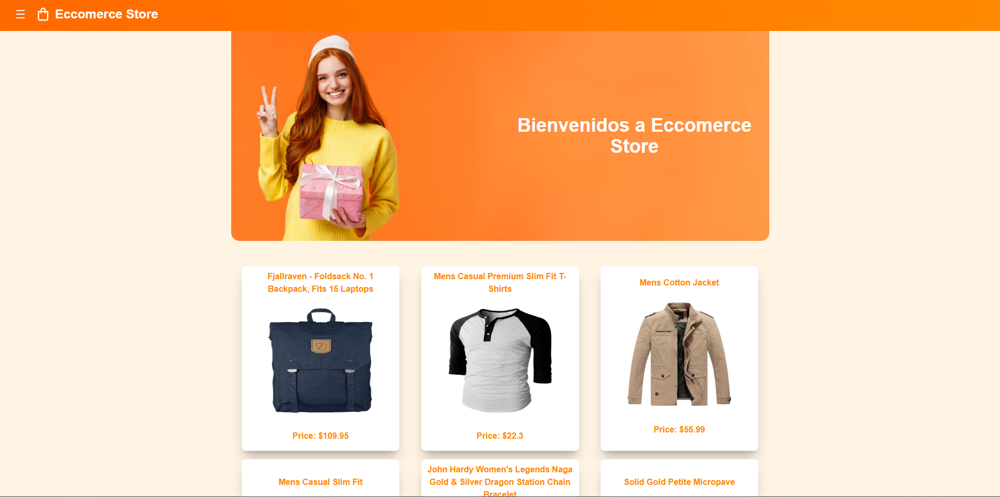
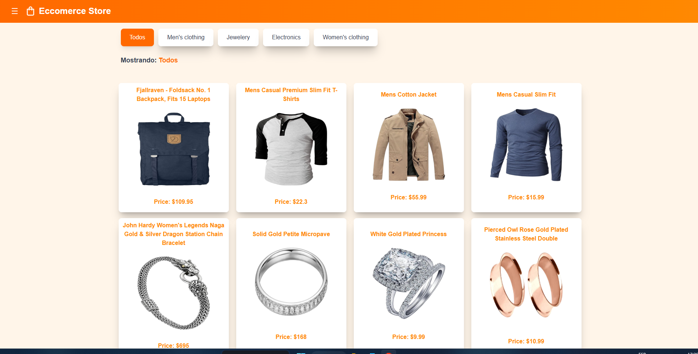
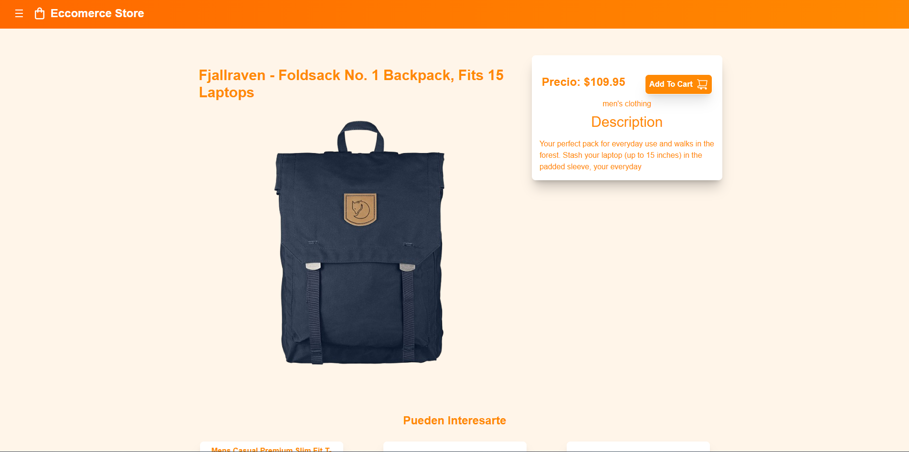

# 🛍️ Ecommerce Store

A modern e-commerce frontend application built with **React, Vite, and Tailwind CSS**, featuring a product catalog, category browsing, individual product pages, and a responsive user interface.

This project demonstrates my frontend development skills, including component-based architecture, API integration, client-side routing, and asynchronous data management.

## 🌐 Live Demo

**[Visit Ecommerce Store](https://my-eccormmerce.vercel.app/)**

## 📸 Screenshots

### 🏠 Home Page

A welcoming homepage featuring a promotional banner and a selection of products.



### 🧭 Navigation Menu

A sidebar menu providing access to the main sections of the application.


### 🛒 Product Catalog

Browse products displayed in a clean grid layout, with category navigation for easier exploration.



### 📦 Product Details

View detailed product information, including images, prices, categories, descriptions, and related products.



## ✨ Features

- **Product Catalog:** Browse products with images, titles, and prices.
- **Product Details:** View detailed information about individual products.
- **Category Navigation:** Explore products by category.
- **Responsive Layout:** Grid layouts adapt to different screen sizes.
- **Client-Side Routing:** Navigate between pages using React Router.
- **API Integration:** Fetch product information from the Fake Store API.
- **Loading States:** Display loading indicators while fetching data.
- **Interactive Navigation:** Access different sections through the navigation menu.
- **Related Products:** Discover additional products from the same category.

## 🛠️ Tech Stack

| Technology | Purpose |
|---|---|
| React | Building reusable UI components |
| Vite | Development server and build tool |
| JavaScript | Application logic |
| Tailwind CSS | Styling and responsive layouts |
| React Router | Client-side navigation |
| TanStack Query | Data fetching and asynchronous state management |
| Fake Store API | Product data |

## 🚀 Getting Started

Follow these steps to run the project locally.

### 1. Clone the repository

```bash
git clone https://github.com/alvaro-sosa1432/eccomerce-my-eco.git
cd eccomerce-my-eco
```

### 2. Install dependencies

```bash
npm install
```

### 3. Start the development server

```bash
npm run dev
```

Open the local URL displayed in your terminal to view the application.

### 4. Build for production

```bash
npm run build
```

## 📁 Project Highlights

This project focuses on practical frontend development concepts such as:

- Building reusable React components
- Working with external APIs
- Managing loading and error states
- Implementing dynamic routes
- Creating responsive product layouts
- Organizing a multi-page frontend application

## 👨‍💻 About the Developer

I'm a Junior Frontend Developer interested in creating modern, responsive, and user-friendly web applications.

I'm available for freelance opportunities involving React development, landing pages, responsive layouts, and frontend improvements.

## 📬 Contact

- **Portfolio:** https://alvaro-sosa1432.vercel.app/
- **GitHub:** https://github.com/alvaro-sosa1432
- **LinkedIn:** https://www.linkedin.com/in/alvaro-sosa1432/

---

Built with ❤️ using React, Vite, and Tailwind CSS.
