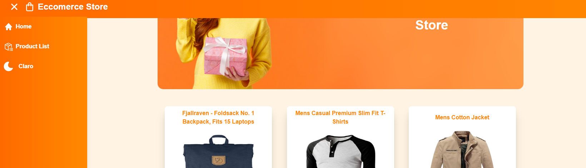

# 🛍️ Ecommerce Store

A modern e-commerce frontend application built with **React, Vite, and Tailwind CSS**, featuring a product catalog, category browsing, individual product pages, and a responsive user interface.

This project demonstrates my frontend development skills, including component-based architecture, API integration, client-side routing, and asynchronous data management.

## 🌐 Live Demo

**[Visit Ecommerce Store](https://my-eccormmerce.vercel.app/)**

## 📸 Screenshots

### 🏠 Home Page

A welcoming homepage featuring a promotional banner and a selection of products.


### 🧭 Navigation Menu

A sidebar menu providing access to the main sections of the application.



### 🛒 Product Catalog

Browse products displayed in a clean grid layout, with category navigation for easier exploration.


### 📦 Product Details

View detailed product information, including images, prices, categories, descriptions, and related products.


## ✨ Features

- **Product Catalog:** Browse products with images, titles, and prices.
- **Product Details:** View detailed information about individual products.
- **Category Navigation:** Explore products by category.
- **Responsive Layout:** Grid layouts adapt to different screen sizes.
- **Client-Side Routing:** Navigate between pages using React Router.
- **API Integration:** Fetch product information from the Fake Store API.
- **Loading States:** Display loading indicators while fetching data.
- **Interactive Navigation:** Access different sections through the navigation menu.
- **Related Products:** Discover additional products from the same category.
- **Authentication:** Email registration and confirmation, sign-in, sign-out, session persistence, and password recovery with Supabase Auth.

## 🛠️ Tech Stack

| Technology | Purpose |
|---|---|
| React | Building reusable UI components |
| Vite | Development server and build tool |
| JavaScript | Application logic |
| Tailwind CSS | Styling and responsive layouts |
| React Router | Client-side navigation |
| TanStack Query | Data fetching and asynchronous state management |
| Fake Store API | Product data |

## 🚀 Getting Started

Use Node.js 22.12+ and pnpm to run the project locally.

### 1. Clone the repository

```bash
git clone https://github.com/alvaro-sosa1432/eccomerce-my-eco.git
cd eccomerce-my-eco
```

### 2. Install dependencies

```bash
pnpm install
```

### 3. Start the development server

```bash
pnpm dev
```

Open the local URL displayed in your terminal to view the application.

### 4. Build for production

```bash
pnpm build
```

## Configurar Supabase Auth

1. Copiá `.env.example` a `.env.local`. En **Connect** o **Settings → API Keys** del Dashboard, obtené la URL del proyecto para `VITE_SUPABASE_URL` y la clave pública para `VITE_SUPABASE_PUBLISHABLE_KEY`. Para una clave pública legacy, dejá esa última variable sin definir y usá `VITE_SUPABASE_ANON_KEY`. Las variables `VITE_*` son públicas. Usá únicamente claves publicables o `anon`. Reiniciá Vite después de editar el archivo. En Vercel, cargá las variables para el entorno correspondiente y generá un nuevo despliegue.
2. En **Authentication → Sign In / Providers**, habilitá **Email** y mantené **Confirm email** activado. Los formularios requieren un mínimo de ocho caracteres. Si el proyecto exige más, Supabase aplica su propia política al guardar la contraseña. Para la confirmación de registro, conservá el enlace `{{ .ConfirmationURL }}` de la plantilla **Confirm signup**.
3. En **Authentication → URL Configuration**, configurá **Site URL** con la URL raíz pública del sitio. Agregá en **Redirect URLs** las URLs raíz exactas con barra final, por ejemplo `http://localhost:5173/` para Vite y `https://my-eccormmerce.vercel.app/` para el despliegue del README. Usá el puerto y dominio que realmente correspondan. La app pasa esta raíz a Supabase y la plantilla de recuperación agrega la ruta de HashRouter.
4. En **Authentication → Email Templates → Reset password**, reemplazá el destino del enlace de recuperación por el siguiente. Conservá el resto de la plantilla según corresponda.

   ```html
   <a href="{{ .RedirectTo }}#/update-password?token_hash={{ .TokenHash }}">
     Restablecer contraseña
   </a>
   ```

   El enlace abre el formulario de recuperación. Al pulsar **Verificar enlace**, la app canjea el token de un solo uso con Supabase. Tras verificarlo, completá el cambio en esa pestaña. Si salís de la página o la recargás antes de guardar, solicitá otro enlace. Si estás usando SMTP propio, desactivá el seguimiento de clics que reescribe enlaces de autenticación.

5. Probá el registro con confirmación, el inicio de sesión, una recarga con sesión activa, el cierre de sesión y un restablecimiento completo. Probá también que `/#/update-password` abierto directamente solicite un enlace, incluso cuando haya una sesión activa.

## Configurar la wishlist

La ruta `/#/wishlist` requiere sesión. Los corazones del catálogo y del detalle guardan únicamente el ID del producto en Supabase. Si visitás la tienda sin sesión, podés volver a la página original después de iniciar sesión y guardar el producto desde allí.

La app usa la tabla `public.wishlists`, con `id` y `user_id` de tipo UUID, `product_id` entero, `created_at` de tipo TIMESTAMPTZ y una restricción única sobre `(user_id, product_id)`. Los campos `id` y `created_at` deben tener valores por defecto. La referencia a `auth.users(id)` usa `ON DELETE CASCADE`.

En Supabase, comprobá que el rol `authenticated` tenga acceso a SELECT, INSERT y DELETE sobre la tabla, y que RLS limite cada operación a las filas donde `user_id` coincide con el usuario autenticado. El detalle de cada favorito se resuelve con Fake Store API.

[Configuración de URLs en Supabase](https://supabase.com/docs/guides/auth/redirect-urls) · [Plantillas de correo](https://supabase.com/docs/guides/auth/auth-email-templates)

## Configurar el carrito

En el proyecto de Supabase que usa la app, abrí **SQL Editor → New query**, pegá el archivo completo [`supabase/migrations/create_mutate_cart.sql`](./supabase/migrations/create_mutate_cart.sql) y ejecutalo sin seleccionar un fragmento. La tabla `public.cart_items` debe existir antes de ejecutar el script. La tabla debe tener `user_id` UUID, `product_id` y `quantity` enteros, unicidad sobre `(user_id, product_id)` y valores por defecto para `id`, `created_at` y `updated_at`. El rol `authenticated` necesita permisos y políticas RLS de SELECT, INSERT, UPDATE y DELETE sobre sus filas. Las políticas de SELECT y DELETE usan `USING (user_id = auth.uid())`. INSERT usa `WITH CHECK (user_id = auth.uid())` y UPDATE requiere ambas condiciones.

La lectura del carrito usa la tabla. Agregar, ajustar, eliminar, vaciar y confirmar la compra dependen de la función `mutate_cart` que instala el script. La función utiliza los permisos y el RLS del usuario autenticado. Los cambios hechos desde la app se serializan por cuenta y el incremento llega hasta 99 unidades por producto.

El checkout es de demostración. La función compara los IDs y cantidades mostrados con el estado del servidor y los elimina en la misma transacción. Ante un conflicto, volvé a revisar el carrito. Si se corta la conexión después del envío, recargá el carrito para comprobar si se aplicó la operación. Los precios son estimados a partir de Fake Store API. La operación no registra órdenes ni procesa pagos.

Para verificar el despliegue, probá con dos cuentas y dos sesiones de una misma cuenta. Revisá el incremento concurrente, el límite de 99 unidades y el rechazo de una confirmación cuyo carrito cambió en la otra sesión.

## 📁 Project Highlights

This project focuses on practical frontend development concepts such as:

- Building reusable React components
- Working with external APIs
- Managing loading and error states
- Implementing dynamic routes
- Creating responsive product layouts
- Organizing a multi-page frontend application

## 👨‍💻 About the Developer

I'm a Junior Frontend Developer interested in creating modern, responsive, and user-friendly web applications.

I'm available for freelance opportunities involving React development, landing pages, responsive layouts, and frontend improvements.

## 📬 Contact

- **Portfolio:** https://alvaro-sosa1432.vercel.app/
- **GitHub:** https://github.com/alvaro-sosa1432
- **LinkedIn:** https://www.linkedin.com/in/alvaro-sosa1432/

---

Built with ❤️ using React, Vite, and Tailwind CSS.
